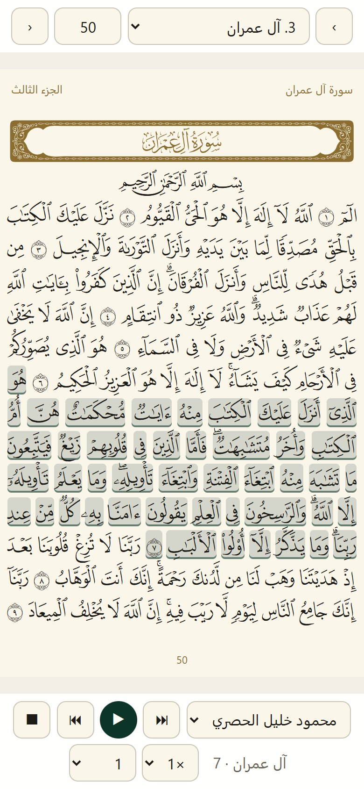
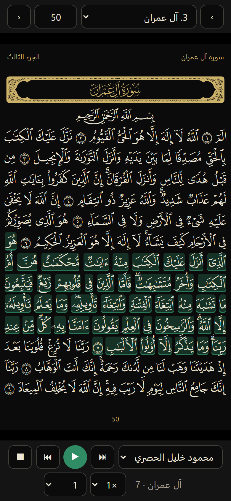

# مكتبة القرآن: المصحف كما طُبع، كلمة كلمة، مع القراء

**العربية** · [English](README.md) · [Türkçe](README.tr.md)

كل ما تحتاجه لوضع مصحف حقيقي في موقع ويب أو تطبيق، مجاناً، وبالطريقة التي نشغّله بها في بيئة الإنتاج:

- **الصفحة كما طُبعت.** مصحف المدينة المنورة طبعة 1421هـ من مجمع الملك فهد (وهو المصحف الذي يعرضه Quran.com و
  Tarteel)، في 604 صفحات، وفي كل صفحة 15 سطراً، مرسوم بخطوط الصفحات التي صممها المجمع نفسه: فيبدو مطابقاً للمطبوع على
  أي هاتف.
- **كلمة كلمة.** كل كلمة عنصر مستقل يعرف سورته وآيته وموضعه: المسها، أو ظلّلها، أو علّمها.
- **ثمانية قراء متزامنون مع النص.** الحصري والمنشاوي والشريم والمعيقلي والدوسري والعفاسي وعبد الباسط وعلي جابر: ملف
  صوتي واحد لكل صفحة، وتُظلَّل الآية التي تُتلى، وتنتقل الصفحة وحدها.
- **سريع وخفيف على الهواتف.** طلب واحد لكل صفحة، وملفات تُخزَّن سنة كاملة، والمصحف يعمل دون اتصال بالإنترنت.
- **استضافة مجانية.** إعداد Cloudflare R2 + Worker خطوة بخطوة، يبقى ضمن الحصص المجانية.
- **لمساعدي الذكاء الاصطناعي.** الملف [`AGENTS.md`](AGENTS.md) و[مهارة Claude Code](skills/quran-mushaf/SKILL.md)
  يتيحان لمساعدك أن يدمج المصحف في تطبيقك بدلاً منك.

<p align="center">
  
  
</p>

## ابدأ في دقيقتين

```bash
git clone https://github.com/ahmadmounir/quran-libary.git
cd quran-libary
npx serve .
```

افتح `http://localhost:3000/example/`، فيعمل المصحف من مجلد `data/` في هذا المستودع. أما الصوت، فابنِ قارئاً مرة واحدة
(تحتاج إلى Node 20+ و ffmpeg؛ نحو ساعة، معظمها في التنزيل):

```bash
node tools/audio/build-reciter.mjs husary    # أو عدة قراء، أو: all للثمانية
```

تنزّل الأداة تسجيلات القارئ من EveryAyah وتعيد بناء ملفاتنا الصوتية مطابقةً لها تماماً (وتتحقق من ذلك وتخبرك).

## الدليل

الشرح الكامل، من ملفات البيانات إلى الاستضافة والتخزين المؤقت والتكلفة:

- **العربية** — [docs/ar/GUIDE.md](docs/ar/GUIDE.md)
- **English** — [docs/en/GUIDE.md](docs/en/GUIDE.md)
- **Türkçe** — [docs/tr/GUIDE.md](docs/tr/GUIDE.md)

## محتوى المستودع

| المجلد | المحتوى |
|---|---|
| `data/mushaf/` | 604 ملفات للصفحات (الأسطر والكلمات، ولكل كلمة رمز رسمها ونصها بترميز Unicode)، وفهرس صفحات الآيات، والسور |
| `data/fonts/` | خطوط الصفحات الـ604 (QCF V2، 93 MB) وخط إطارات السور |
| `data/audio/` | القراء الثمانية، ولكل قارئ موضع بداية كل آية داخل ملف كل صفحة |
| `tools/audio/` | بناء ملفات الصفحات الصوتية من تسجيلات الآيات (مطابقة لملفاتنا بايتاً ببايت) |
| `tools/cloudflare/` | الرفع إلى R2، والـ Worker الذي يقدّم الملفات |
| `example/` | تطبيق كامل بلغة JavaScript عادية: الصفحات، كلمة كلمة، الصوت، العمل دون اتصال |
| `AGENTS.md` و`skills/` | تعليمات لمساعدي البرمجة بالذكاء الاصطناعي |

الملفات الصوتية نفسها (6.2 GB لثمانية قراء) ليست في git؛ والأدوات تعيد بناءها.

## الاستعانة بمساعد ذكاء اصطناعي

افتح مشروعك في Claude Code (أو أي وكيل برمجة آخر)، واجعل هذا المستودع متاحاً له، ثم اطلب:

> أضف المصحف إلى تطبيقي باتباع quran-libary/AGENTS.md

ومع Claude Code يمكنك أيضاً نسخ `skills/quran-mushaf/` إلى `.claude/skills/` في مشروعك.

## الترخيص

الشيفرة والأدلة المكتوبة لهذا المستودع منشورة بموجب [ترخيص MIT](LICENSE). أما الخطوط وبيانات الصفحات والتسجيلات فهي
لأصحابها (انظر أدناه).

## شكر وتقدير

قام هذا العمل على جهود من سبقونا، ونشكرهم شكراً صادقاً:

- **مجمع الملك فهد لطباعة المصحف الشريف** (المدينة المنورة): على مصحف المدينة وخطوط صفحاته (QCF V2)، المستخدمة دون أي
  تعديل.
- **منصة Tarteel — المكتبة القرآنية الشاملة (Quranic Universal Library، QUL)**: على بيانات تخطيط الصفحات ورموز الكلمات
  كلمةً كلمة التي بُنيت منها ملفات صفحاتنا، وعلى خط إطارات السور.
- **موقع Quran.com ومؤسسة Quran Foundation**: على معرّفات الكلمات، وعلى العمل المفتوح الذي أنار لنا الطريق.
- **موقع EveryAyah.com**: على تسجيلات الآيات آيةً آية التي بُنيت منها ملفاتنا الصوتية.
- **القراء**: الشيخ محمود خليل الحصري، والشيخ محمد صديق المنشاوي، والشيخ سعود الشريم، والشيخ ماهر المعيقلي، والشيخ
  ياسر الدوسري، والشيخ مشاري راشد العفاسي، والشيخ عبد الباسط عبد الصمد، والشيخ علي جابر — جزاهم الله خيراً.

جميع الحقوق في الخطوط وبيانات الصفحات والتسجيلات محفوظة لأصحابها. ونحن نشاركها هنا مجاناً، خدمةً غير تجارية لكل من
يخدم كتاب الله. إن كنت تبني شيئاً تجارياً، فاقرأ شروط كل مصدر أولاً.
